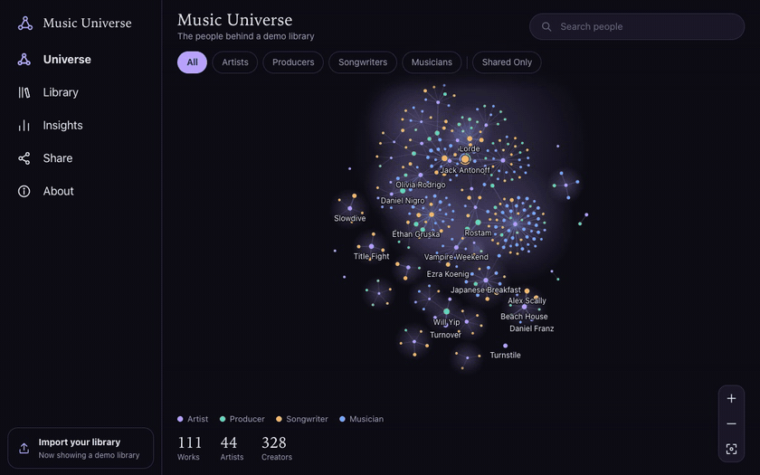
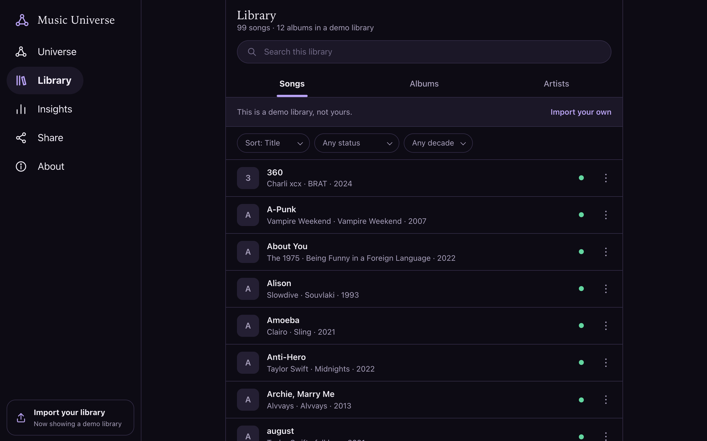
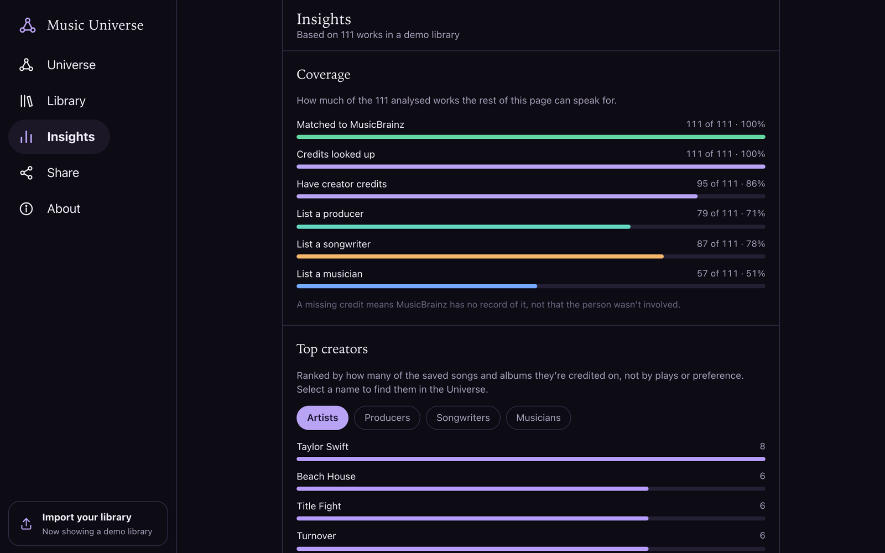
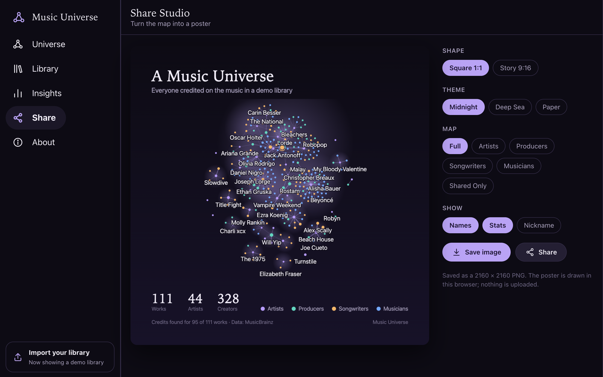
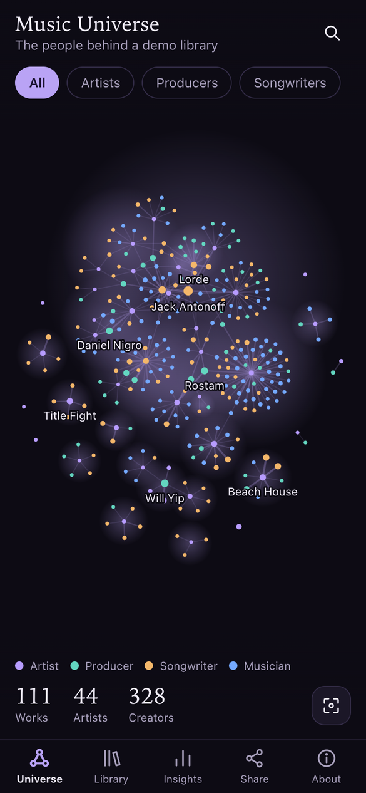
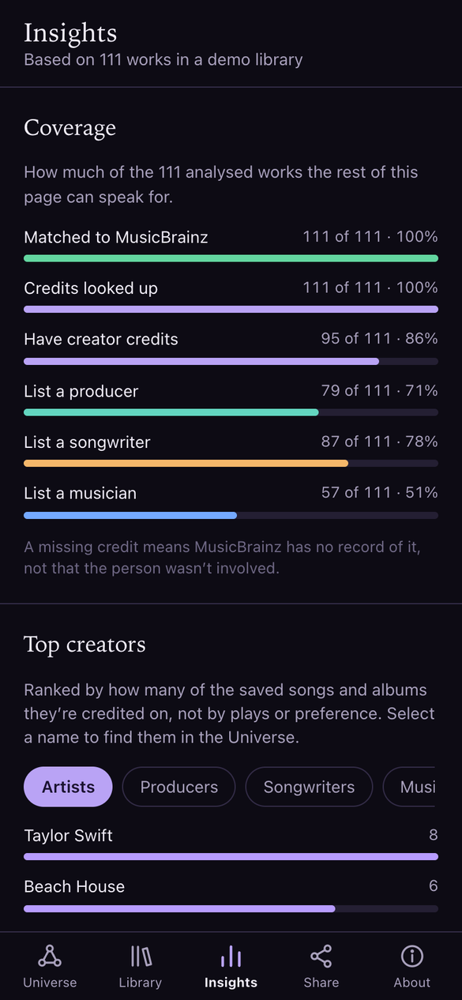
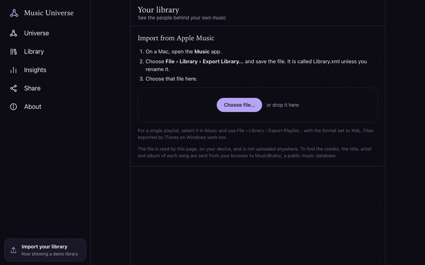

# Music Universe

A map of the people behind a music library: artists, producers, songwriters and musicians, joined wherever they are credited on the same song or album.

**Open it: https://catherineruoxiwu.github.io/music-universe/**



It opens on a demo library. To see your own, export your library from the Music app on a Mac and [import the file](https://catherineruoxiwu.github.io/music-universe/#/import).

## What you can do

- **Universe**: an interactive map of everyone credited in the library. Filter by role, show only people shared between artists, search for a name, and select anyone to see the works that connect them.
- **Library**: every song with what was found for it. Exclude a song from the analysis, confirm or reject a doubtful match, or look a song up again.
- **Insights**: coverage, top creators, genres, release decades, and "hidden connections" — people who link different artists in the library.
- **Share**: a poster of your universe, saved as a PNG.

| Library | Insights | Share |
| --- | --- | --- |
|  |  |  |

It works on a computer (navigation on the left) and on a phone (tabs along the bottom).

<p>
  
  
</p>

## Import your Apple Music library

1. On a Mac, open the **Music** app.
2. Choose **File › Library › Export Library…** and save the file (`Library.xml`).
3. On the [import page](https://catherineruoxiwu.github.io/music-universe/#/import), choose that file, then pick what to import: the whole library, your favourites, or one playlist.



*The lookups in this recording are played at 12 times their real speed; these 30 songs took about three minutes.*

To export a single playlist instead, select it in Music and use **File › Library › Export Playlist…** with the format set to XML. Files exported by iTunes on Windows have the same format.

Things to know:

- **It is slow.** Each song is looked up on MusicBrainz, which allows one request a second. Expect about 3.5–5 seconds a song, so roughly an hour for 1,000 songs. Try a playlist first.
- **Keep the tab open** while it runs. You can pause and resume, and it carries on from where it stopped after a reload.
- **Results stay in the browser that made them.** Another browser or device starts from the demo library.
- **Importing again starts over**, even with the same file ([#1](https://github.com/catherineruoxiwu/music-universe/issues/1)).
- Only songs are imported. Videos, podcasts and audiobooks are skipped.

There is no sign-in to Apple Music, Spotify, QQ Music or NetEase Cloud Music.

## Privacy

There is no account, no server and no analytics.

- The file you import is read in your browser and is not uploaded.
- To find credits, the title, artist and album of each imported song are sent from your browser to [MusicBrainz](https://musicbrainz.org), which also sees your IP address. Nothing else in the file leaves your device.
- The imported songs, what was found for them, and your settings are kept in the browser's storage until you delete them (Import page or About page).

## How it works

- **Reading the file**: a small property-list parser reads the export (`src/import`).
- **Matching**: each song is searched on MusicBrainz and the candidates are scored on title, artist and duration. A confident match is accepted, a doubtful one is shown as "Needs review", and anything else is left unmatched rather than guessed (`src/enrich`). Traditional and Simplified Chinese are treated as the same text, and artists are also recognised by their other names (周杰倫 / Jay Chou).
- **Credits**: one request per matched recording returns performers, production credits, writers and genres.
- **Rate limit**: requests go one at a time, at least 1.1 seconds apart, and back off when MusicBrainz says it is busy. Only one tab does lookups at a time.
- **The map**: a force-directed layout drawn on a canvas (`src/graph`).
- **Storage**: the imported library lives in IndexedDB; settings and the layout in localStorage.

The site is static files. It is written in TypeScript without a UI framework and has no runtime dependencies.

## Development

Requires Node.js 20.19+ or 22.12+.

```sh
npm install
npm run dev       # local server with reload
npm test          # unit tests
npm run build     # type-check and build into dist/
npm run preview   # serve the built site
npm run deploy    # build and publish dist/ to the gh-pages branch
```

`npm run deploy` force-pushes a single commit to `gh-pages`, which GitHub Pages serves. The source lives on `main`.

```
src/
  import/    reading an Apple Music export
  enrich/    MusicBrainz client, matching, credits, the lookup runner
  library/   the imported library and its storage
  graph/     graph building, layout, canvas rendering
  insights/  the numbers behind the Insights page
  share/     the poster
  state/     the store the pages read from
  ui/        the pages
  data/      the demo library
tests/       unit tests
```

## Known limits

- Lookups are slow, and a first import cannot be made faster from the browser alone ([#2](https://github.com/catherineruoxiwu/music-universe/issues/2), [#3](https://github.com/catherineruoxiwu/music-universe/issues/3)).
- MusicBrainz is community-maintained and incomplete. A missing credit does not mean someone was not involved.
- Tested in Chrome. Safari, Firefox and long imports in a background tab have not been tested.

## Data

Credits and genres come from [MusicBrainz](https://musicbrainz.org). Its core data is released under [CC0](https://creativecommons.org/publicdomain/zero/1.0/); genres and tags are licensed [CC BY-NC-SA 3.0](https://creativecommons.org/licenses/by-nc-sa/3.0/).

The demo library is a hand-picked list of songs, not anyone's real library; its credits were looked up on MusicBrainz ahead of time.

Not affiliated with or endorsed by MusicBrainz, Apple or any artist or label named here.
